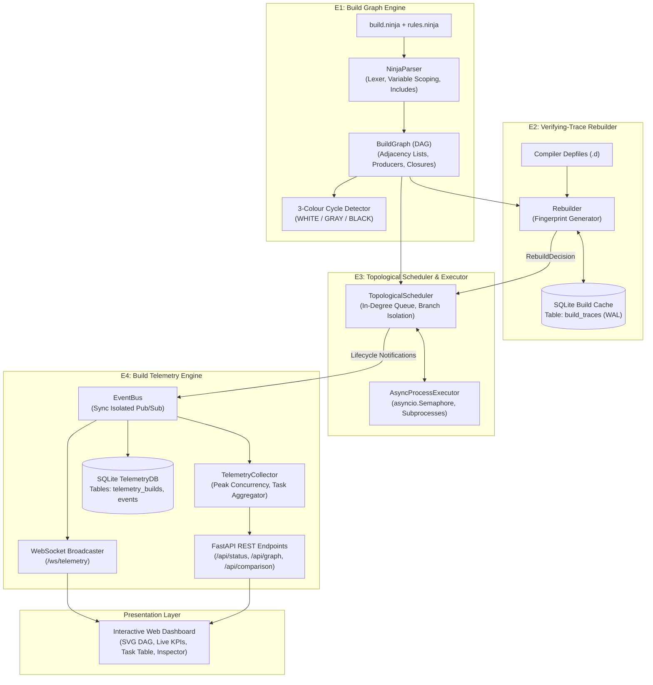
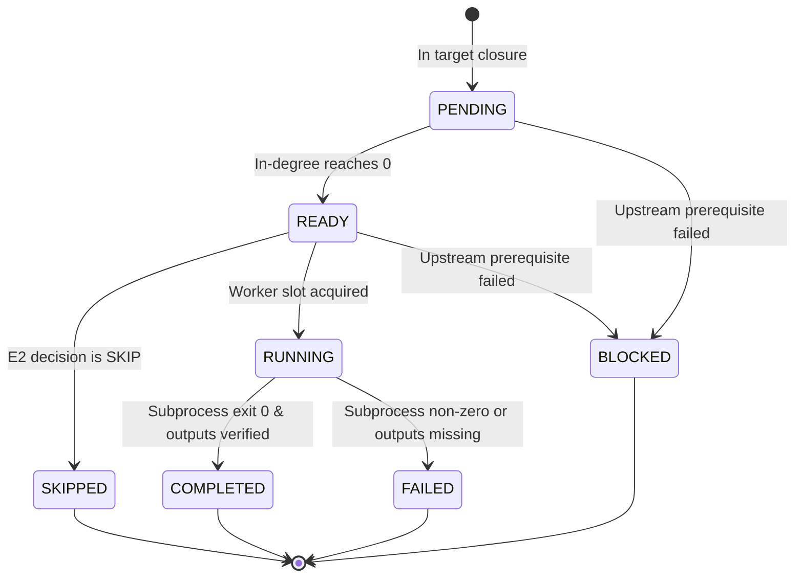
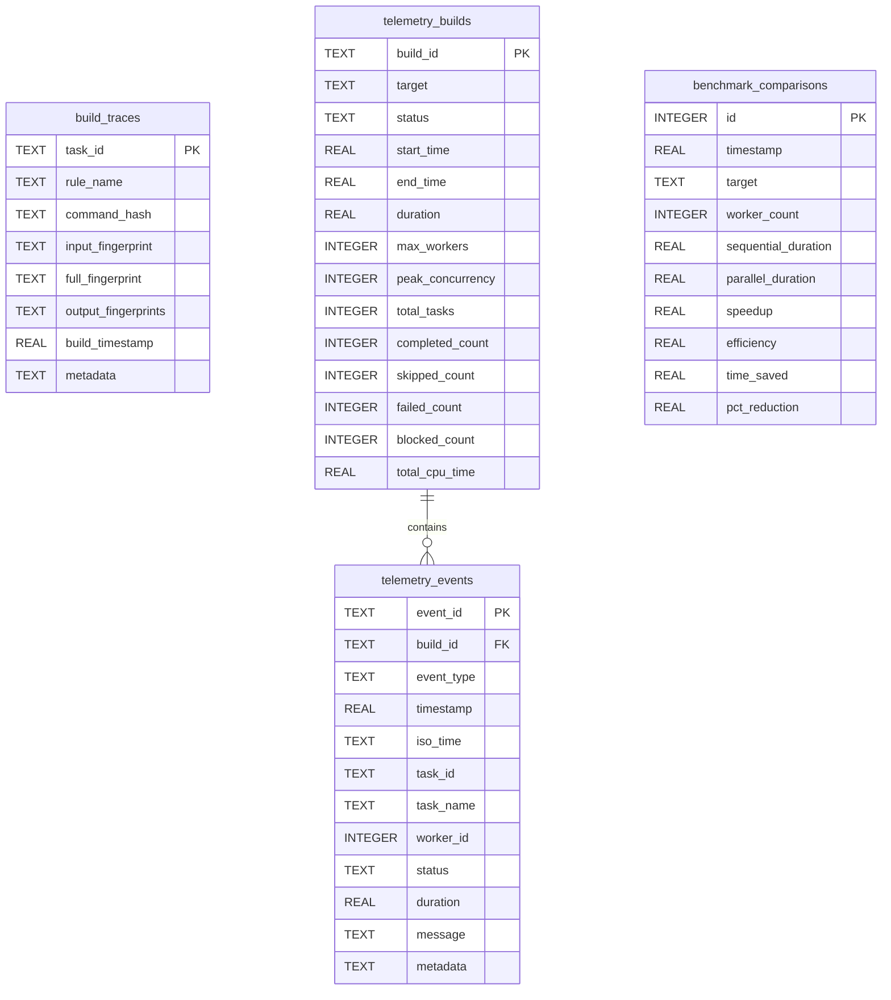

# Architecture Specification — Dependency-Aware Parallel Task Orchestration Engine

---

## 1. Theoretical Grounding & Academic Context

This build orchestration engine implements the core formalisms presented in the seminal functional systems paper:

> **"Build Systems à la Carte: Theory and Practice"**  
> *Andrey Mokhov, Neil Mitchell, and Simon Peyton Jones*  
> *Journal of Functional Programming / ACM Haskell Symposium*

The paper classifies all build systems along two orthogonal axes:
1. **The Scheduler Dimension:** The algorithm used to traverse the task graph and determine the execution sequence.
2. **The Rebuilder Dimension:** The decision mechanism used to verify whether a task must execute or can be skipped.

### Classification Matrix

| Dimension | Classification in This Engine | Functional Behavior |
| :--- | :--- | :--- |
| **Scheduler** | **Topological Scheduler** | Operates on a statically discoverable DAG. Maintains dynamic in-degree counters; tasks transition to `READY` when all prerequisites complete or skip. Parallel execution is managed via asynchronous bounded concurrency. |
| **Rebuilder** | **Verifying-Trace Rebuilder** | Uses persistent records of previous successful builds (traces). Instead of unreliable filesystem modification timestamps (`mtime`), it validates SHA-256 fingerprints of command strings, variables, inputs, and compiler-generated dependency files. |
| **Executor** | **Bounded Asynchronous Subprocess Pool** | Manages OS-level child processes (`g++`, `ar`) through Python's `asyncio` event loop and `asyncio.Semaphore`. |
| **Telemetry** | **Structured Reactive Event Bus** | Decoupled observer model broadcasting 9 typed lifecycle transitions to a WebSocket server and persisting telemetry history to SQLite. |

---

## 2. High-Level Subsystem Architecture

The engine is partitioned into four decoupled subsystems (**E1** through **E4**), preventing circular dependencies and ensuring strict separation of concerns.



---

## 3. Subsystem Specifications & Contracts

### E1 — Build Graph Engine
* **Source Modules:** [`engine/ninja_parser.py`](file:///c:/Users/nilak/Github/Mini%20Project(Dependency%20Aware%20Task%20Orchestration%20Engine)/engine/ninja_parser.py), [`engine/models.py`](file:///c:/Users/nilak/Github/Mini%20Project(Dependency%20Aware%20Task%20Orchestration%20Engine)/engine/models.py), [`engine/dag.py`](file:///c:/Users/nilak/Github/Mini%20Project(Dependency%20Aware%20Task%20Orchestration%20Engine)/engine/dag.py)
* **Contract:** Consumes CMake-generated Ninja manifests; exposes an immutable, cycle-free dependency graph.

#### Key Mechanisms:
1. **Manifest Parsing:**
   - Progressive tokenization and parsing of `build.ninja` and nested `include rules.ninja`.
   - Resolves variable scoping and recursive substitutions (`$in`, `$out`, `$FLAGS`, `${var}`).
   - Handles line continuations (`$\n`), escaped colons (`$:`), and paths containing spaces.
2. **Dependency Categorization:**
   - **Explicit Dependencies:** Appear before `|`. Direct inputs substituted into `$in`. Changes trigger rebuilds.
   - **Implicit Dependencies:** Appear between `|` and `||`. Changes trigger rebuilds.
   - **Order-Only Dependencies:** Appear after `||`. Enforces topological ordering; changes do **not** invalidate downstream fingerprints.
   - **Phony Aliases:** Registered as virtual routing edges; never dispatched as OS subprocesses.
3. **Cycle Detection (Three-Colour DFS):**
   - Nodes are colored `WHITE` (unvisited), `GRAY` (actively being explored in current recursion path), or `BLACK` (fully explored).
   - If a traversal encounters a `GRAY` node, a `CycleError` is thrown containing the exact directed cycle path (e.g., `A -> B -> C -> A`).
4. **Target-Specific Dependency Closure:**
   - Performs reverse depth-first traversal from the requested target (e.g. `demo.exe`), pruning unneeded tasks (such as `test_runner.exe`).

---

### E2 — Verifying-Trace Rebuilder
* **Source Modules:** [`engine/rebuilder.py`](file:///c:/Users/nilak/Github/Mini%20Project(Dependency%20Aware%20Task%20Orchestration%20Engine)/engine/rebuilder.py), [`engine/cache.py`](file:///c:/Users/nilak/Github/Mini%20Project(Dependency%20Aware%20Task%20Orchestration%20Engine)/engine/cache.py)
* **Contract:** Determines whether a task must build (`BUILD`) or can be bypassed (`SKIP`).

#### Deterministic Fingerprinting Formula:
For any task $T$, its full cryptographic fingerprint $F(T)$ is computed as:
$$F(T) = \mathcal{H}_{\text{SHA-256}}\Big(\text{RuleName} \parallel \text{CommandString} \parallel \mathcal{H}(\text{ExplicitInputs}) \parallel \mathcal{H}(\text{ImplicitInputs}) \parallel \mathcal{H}(\text{DepfileHeaders})\Big)$$

* **Exclusion of Order-Only Inputs:** Order-only prerequisites enforce sequencing but are strictly excluded from $F(T)$.
* **Compiler Depfile Parser:** Parses GCC/Clang `-MD -MT $out -MF $DEP_FILE` `.d` files to include header dependencies dynamically.
* **Early Cut-Off Optimization:** If an upstream task rebuilds but produces identical outputs, downstream tasks verify that their input fingerprint remains unchanged and safely skip recompilation.

#### Rebuild Decision Matrix:
| Previous Trace State | On-Disk Output State | Input / Command State | RebuildDecision | Reason |
| :---: | :---: | :---: | :---: | :--- |
| **Missing** | Any | Any | `BUILD` | `FIRST_BUILD` (no previous trace) |
| **Exists** | Missing | Any | `BUILD` | `OUTPUT_MISSING` (artifact deleted) |
| **Exists** | Corrupted / Changed | Any | `BUILD` | `OUTPUT_MODIFIED` (external tampering) |
| **Exists** | Valid | Fingerprint Mismatch | `BUILD` | `INPUT_CHANGED` or `COMMAND_CHANGED` |
| **Exists** | Valid | Fingerprint Matches | `SKIP` | `UP_TO_DATE` (zero subprocess overhead) |

---

### E3 — Topological Scheduler & Parallel Executor
* **Source Modules:** [`engine/scheduler.py`](file:///c:/Users/nilak/Github/Mini%20Project(Dependency%20Aware%20Task%20Orchestration%20Engine)/engine/scheduler.py), [`engine/executor.py`](file:///c:/Users/nilak/Github/Mini%20Project(Dependency%20Aware%20Task%20Orchestration%20Engine)/engine/executor.py), [`engine/orchestrator.py`](file:///c:/Users/nilak/Github/Mini%20Project(Dependency%20Aware%20Task%20Orchestration%20Engine)/engine/orchestrator.py)
* **Contract:** Coordinates concurrent task execution respecting dependencies, worker caps, and failure semantics.

#### Execution Architecture & Worker Slot Acquisition:
To prevent race conditions and ensure telemetry accurately reports physical subprocess execution rather than queued coroutines:
1. Tasks with $\text{in-degree} = 0$ enter the `ready_queue`.
2. Tasks marked `SKIP` by E2 bypass worker allocation entirely, immediately unblocking downstream dependents.
3. For tasks requiring execution, the scheduler launches an asynchronous worker coroutine that acquires an `asyncio.Semaphore` slot.
4. **Execution-Start Signaling:** The task emits `TASK_STARTED` and acquires an active `worker_id` (`1..p`) **after** acquiring the semaphore, ensuring that active worker metrics reflect actual running subprocesses.
5. The subprocess executes in the target directory (`cwd`). Upon termination with exit code 0, declared output files are validated on disk before marking the task `COMPLETED`.

#### Failure Propagation & Branch Isolation:
```text
            [Task A (Fails)]                 [Task B (Succeeds)]
                   │                                  │
                   ▼                                  ▼
         [Task C: BLOCKED]                  [Task D: COMPLETED]
                   │                                  │
                   ▼                                  ▼
         [Task E: BLOCKED]                  [Task F: COMPLETED]
```
* **Downstream Blocking:** When a task fails, all transitive downstream dependents are immediately transitioned to `BLOCKED` with an explanatory error message.
* **Independent Branch Continuation:** Independent task trees continue executing uninterrupted. The build completes with `overall_success = False` only after all independent work finishes.

---

### E4 — Build Telemetry Engine & Live Dashboard
* **Source Modules:** [`telemetry/collector.py`](file:///c:/Users/nilak/Github/Mini%20Project(Dependency%20Aware%20Task%20Orchestration%20Engine)/telemetry/collector.py), [`telemetry/event_bus.py`](file:///c:/Users/nilak/Github/Mini%20Project(Dependency%20Aware%20Task%20Orchestration%20Engine)/telemetry/event_bus.py), [`telemetry/db.py`](file:///c:/Users/nilak/Github/Mini%20Project(Dependency%20Aware%20Task%20Orchestration%20Engine)/telemetry/db.py), [`api/`](file:///c:/Users/nilak/Github/Mini%20Project(Dependency%20Aware%20Task%20Orchestration%20Engine)/api/), [`dashboard/`](file:///c:/Users/nilak/Github/Mini%20Project(Dependency%20Aware%20Task%20Orchestration%20Engine)/dashboard/)
* **Contract:** Observes and persists build execution telemetry without modifying scheduling behavior.

#### Lifecycle State Machine:


#### Frontend State Precedence Protection:
To eliminate race conditions between real-time WebSocket events and asynchronous REST polling (`/api/status`, `/api/graph`), the frontend enforces a strict monotonic rank hierarchy:
$$\text{PENDING (0)} < \text{READY (1)} < \text{RUNNING (2)} < \text{COMPLETED / SKIPPED / FAILED / BLOCKED (3)}$$
Once a task achieves a terminal status (rank 3), incoming stale snapshot events are rejected.

---

## 4. Database Schema Specifications

Both build traces (E2) and telemetry history (E4) share `data/build_state.db` safely under independent schemas operating in SQLite Write-Ahead Logging (WAL) mode.



---

## 5. Concurrency & Execution Proof

### Prerequisite Completion Invariant:
For any task $D$ and its prerequisite $P$:
$$T_{\text{start}}(D) \ge T_{\text{end}}(P)$$

Empirical verification from execution trace:
* `utils.cpp.obj`: Completed at $t = 3.7362\text{ s}$
* `libmylib.a`: Started at $t = 3.7887\text{ s}$ ($> 3.7362\text{ s}$)
* `demo.exe`: Started at $t = 3.9815\text{ s}$ ($> 3.9772\text{ s}$, after archive completion)

The archive and linking tasks strictly await prerequisite completion before worker acquisition.
