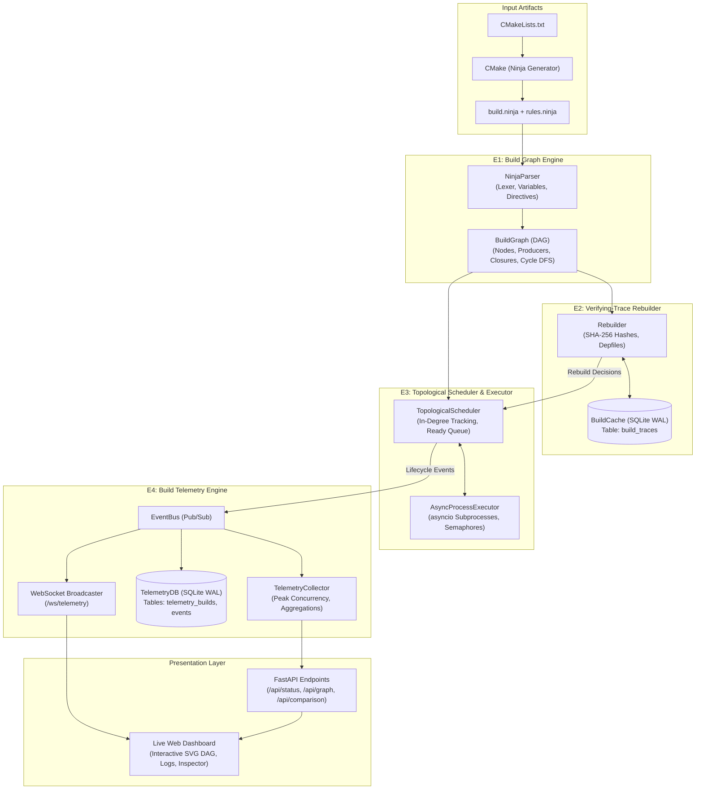
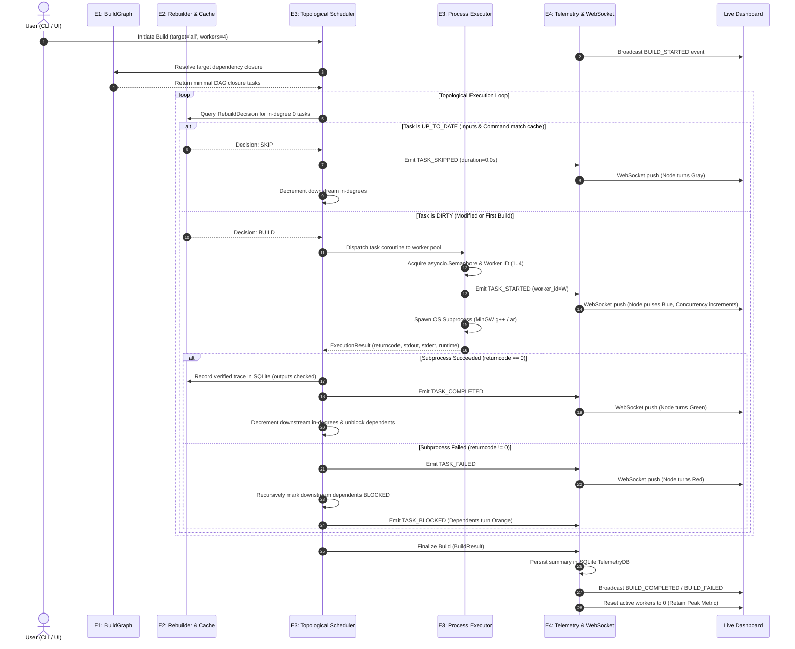

# Dependency-Aware Parallel Task Orchestration Engine

[](https://www.python.org/)
[](https://fastapi.tiangolo.com/)
[](https://websockets.readthedocs.io/)
[](https://www.sqlite.org/)
[](https://cmake.org/)
[](https://www.gnu.org/software/gcc/)
[]()
[]()

> A high-performance, asynchronous, dependency-aware task orchestration and build execution engine in Python. Inspired by Google's **Ninja** build system and grounded in the theoretical framework of ***"Build Systems à la Carte: Theory and Practice"*** (Mokhov, Mitchell, & Peyton Jones).
>
> Developed as an academic university Mini Project in **Systems Software and Parallel Computing**.

---

## Table of Contents

1. [Overview](#1-overview)
2. [Key Features](#2-key-features)
3. [System Architecture](#3-system-architecture)
4. [Detailed Execution Flow](#4-detailed-execution-flow)
5. [Technology Stack](#5-technology-stack)
6. [Repository Structure](#6-repository-structure)
7. [Installation & Environment Setup](#7-installation--environment-setup)
8. [Running the Project](#8-running-the-project)
9. [Empirical Benchmark Results](#9-empirical-benchmark-results)
10. [Test Suite Verification](#10-test-suite-verification)
11. [Design Decisions & Research Foundation](#11-design-decisions--research-foundation)
12. [Current Limitations](#12-current-limitations)
13. [Future Work](#13-future-work)
14. [Academic Project Information](#14-academic-project-information)
15. [Documentation Links](#15-documentation-links)

---

## 1. Overview

### The Build Orchestration Problem
Modern software projects consist of hundreds or thousands of interdependent tasks: compiling C++ compilation units, parsing interface files, generating object archives, and linking executable binaries. These tasks form a **Directed Acyclic Graph (DAG)** where task $B$ cannot execute until task $A$ completes successfully.

Traditional build utilities suffer from two core limitations:
1. **Coarse Timestamp Invalidation (`mtime`):** Traditional tools compare file modification timestamps. Touching a header file, switching Git branches, or encountering filesystem clock skew triggers massive, unnecessary rebuild cascades.
2. **Black-Box Scheduling:** Developers lack fine-grained, real-time observability into critical path bottlenecks, dynamic in-degree task readiness, worker pool utilization, and failure propagation across independent dependency branches.

### Dependency-Aware Parallel Execution
The **Dependency-Aware Parallel Task Orchestration Engine** reads real CMake-generated `build.ninja` manifests, constructs a mathematical DAG, and computes execution schedules dynamically.

```text
       [math.cpp]        [utils.cpp]        [stringops.cpp]        [fileio.cpp]
           │                  │                    │                    │
           ▼                  ▼                    ▼                    ▼
     [math.cpp.obj]     [utils.cpp.obj]    [stringops.cpp.obj]    [fileio.cpp.obj]
           │                  │                    │                    │
           └──────────────────┼────────────────────┴────────────────────┘
                              ▼
                        [libmylib.a] ──────────────┐
                              │                    │
                              ▼                    ▼
                          [demo.exe]        [test_runner.exe]
```

* **Sequential Execution ($1$ worker):** Tasks execute one-by-one in topological order ($T_1 \approx 4.900\text{ s}$).
* **Parallel Execution ($4$ workers):** Independent compilation units execute concurrently across worker processes, constrained only by prerequisite completion ($T_4 \approx 2.075\text{ s}$, yielding a **$2.36\times$ empirical speedup** and **$57.6\%$ wall-clock reduction**).

---

## 2. Key Features

* **Real CMake Ninja Manifest Parser:** Progressive recursive descent parser supporting build rules, variable expansions (`$in`, `$out`, `${var}`), line continuations (`$\n`), include directives, and paths containing whitespace.
* **Adjacency-List Dependency DAG:** Graph model tracking **explicit** (code-level), **implicit** (generated headers), and **order-only** (sequencing only) dependencies.
* **Three-Colour DFS Cycle Detection:** Evaluates nodes across `WHITE` (unvisited), `GRAY` (in recursion stack), and `BLACK` (completed) states, outputting exact cyclical paths (`A -> B -> C -> A`) on errors.
* **Target-Specific Closures:** Computes reverse dependency closures to build only what is required (e.g. `demo.exe` builds only its library prerequisites, skipping unrelated test binaries).
* **Verifying-Trace Incremental Rebuilding:** Replaces brittle filesystem timestamps with cryptographic SHA-256 fingerprinting across commands, rule definitions, and input file contents.
* **Deep Compiler Depfile Tracking:** Parses GCC/Clang Makefile-style `.d` dependency files at runtime to detect header modifications across transitive `#include` hierarchies.
* **Early Cut-Off & Up-to-Date Skips:** Tasks whose inputs and commands are unchanged bypass subprocess creation with zero scheduling overhead ($0.000\text{ s}$ CPU time).
* **Bounded Asynchronous Parallel Executor:** Concurrency strictly regulated via `asyncio.Semaphore` with dynamic worker pool assignment (`Worker 1..4`).
* **Failure Isolation & Non-Blocking Branches:** When a task fails (non-zero exit code or missing outputs), its downstream dependents are marked `BLOCKED`, while completely independent branches continue running to completion.
* **Unified SQLite Persistence:** WAL-mode SQLite storage maintaining cryptographic `build_traces` alongside comprehensive `telemetry_builds` and `telemetry_events`.
* **Real-Time Telemetry & WebSocket Streaming:** Event-driven architecture broadcasting 9 typed lifecycle transitions to connected clients in sub-millisecond intervals.
* **Interactive Live Dashboard:** Modern dark-themed dashboard featuring an SVG DAG visualization, live duration timer, real-time KPI metrics, execution inspector, and historical benchmark charts.
* **Unified CLI:** Single command-line interface (`cli.py`) for building, benchmarking, inspecting history, launching the dashboard, and running the test suite.

---

## 3. System Architecture

The engine is modularized into four functional subsystems (E1–E4), establishing clean boundaries between graph construction, caching, scheduling, and observability.



### Subsystem Responsibilities

| Subsystem | Core Question Answered | Implementation Highlights |
| :--- | :--- | :--- |
| **E1 — Build Graph Engine** | *What depends on what?* | Parses manifest syntax, resolves aliases/phonies, indexes output producers, performs 3-colour cycle detection, and isolates target closures. |
| **E2 — Verifying-Trace Rebuilder** | *Does this task need rebuilding?* | Computes deterministic SHA-256 fingerprints of command strings, variables, and inputs. Parses compiler `.d` depfiles for transitive headers. |
| **E3 — Topological Scheduler & Executor** | *When and how can tasks execute?* | Manages in-degree readiness queues. Limits parallel concurrency via `asyncio.Semaphore`. Isolates failures and propagates `BLOCKED` states downstream. |
| **E4 — Build Telemetry Engine** | *What happened, and how well did it perform?* | Captures structured lifecycle events. Tracks simultaneous subprocess peak concurrency. Persists history and broadcasts real-time states over WebSockets. |

---

## 4. Detailed Execution Flow



---

## 5. Technology Stack

### Backend & Core Engine
* **Python 3.11+:** Asynchronous event loop (`asyncio`), dataclasses, type annotations.
* **FastAPI (`>=0.104.0`):** High-performance asynchronous REST API server.
* **Uvicorn (`>=0.24.0`):** Production ASGI web server.
* **WebSockets (`>=12.0`):** Real-time bidirectional event streaming.
* **SQLite 3 (WAL Mode):** Embedded ACID transactional storage for build traces and telemetry.
* **Cryptographic Hashing:** Standard library `hashlib.sha256` for file and command fingerprinting.

### Frontend Dashboard
* **HTML5 & CSS3:** Responsive modern dark developer theme with CSS variables.
* **Vanilla JavaScript (ES6+):** Dependency-free client controller with WebSocket reconnection management.
* **Dynamic Scalable Vector Graphics (SVG):** Programmatic DAG layout and state rendering.

### Demonstration Workload
* **Compiler & Linker:** MinGW GNU C++ (`g++ 15.2.0`, `ar 2.44`).
* **Manifest Generator:** CMake 4.3.1 generating Ninja manifest format.
* **C++ Codebase:** Multi-file modular project containing `mylib` static archive, `demo.exe`, and unit test runner.

---

## 6. Repository Structure

```text
Mini-Project-Dependency-Aware-Orchestration-Engine/
├── .gitignore                      # Git exclusion rules (caches, .venv, local DBs)
├── ARCHITECTURE.md                 # In-depth subsystem specification & data contracts
├── BENCHMARK_REPORT.md             # Empirical performance trials and Amdahl analysis
├── DEMO_GUIDE.md                   # 7-10 minute presentation sequence & talking points
├── README.md                       # Repository documentation and user guide
├── cli.py                          # Unified Command-Line Interface
├── requirements.txt                # Production and test Python dependencies
├── run_dashboard.py                # Standalone dashboard server launcher
│
├── api/                            # FastAPI backend & WebSocket endpoints
│   ├── __init__.py
│   ├── main.py                     # REST router, build triggers, artifact cleaners
│   └── websocket.py                # WebSocket connection manager & broadcast bus
│
├── benchmarks/                     # Reproducible performance benchmark suite
│   ├── benchmark.py                # Statistical measurement harness (multi-trial)
│   └── run_reproducible_benchmark.py # Automated 1w vs 4w comparative runner
│
├── dashboard/                      # Web dashboard frontend
│   ├── app.js                      # WebSocket client, SVG renderer, state management
│   ├── index.html                  # Responsive multi-tab dashboard layout
│   └── style.css                   # Dark theme, status color palettes, animations
│
├── data/                           # Runtime database directory
│   └── .gitkeep                    # Preserves folder (build_state.db is git-ignored)
│
├── engine/                         # Core orchestration subsystems (E1, E2, E3)
│   ├── __init__.py
│   ├── cache.py                    # SQLite WAL build trace cache (E2)
│   ├── dag.py                      # BuildGraph, cycle detection, closures (E1)
│   ├── executor.py                 # AsyncProcessExecutor, semaphore worker pool (E3)
│   ├── models.py                   # TaskNode, BuildRule, BuildEdge data structures
│   ├── ninja_parser.py             # Progressive Ninja manifest & depfile parser (E1)
│   ├── orchestrator.py             # High-level pipeline coordinator
│   ├── rebuilder.py                # Verifying-trace SHA-256 rebuilder (E2)
│   ├── scheduler.py                # In-degree topological scheduler (E3)
│   └── telemetry.py                # Collector adapter & bridge
│
├── examples/                       # Target demonstration workload
│   └── cpp_demo/                   # Real CMake C++ project
│       ├── CMakeLists.txt          # Build definition
│       ├── build/                  # CMake build manifest folder
│       │   ├── CMakeCache.txt      # Compiler cache
│       │   ├── build.ninja         # CMake-generated Ninja manifest
│       │   └── CMakeFiles/
│       │       └── rules.ninja     # GCC compilation & archive rules
│       └── src/                    # C++ source code and headers
│           ├── fileio.cpp / .h     # File I/O module
│           ├── main.cpp            # demo.exe entry point
│           ├── math.cpp / .h       # Math functions module
│           ├── stringops.cpp / .h  # String operations module
│           ├── test_runner.cpp     # test_runner.exe entry point
│           └── utils.cpp / .h      # Utilities module
│
├── telemetry/                      # Telemetry capture & persistence layer (E4)
│   ├── __init__.py
│   ├── collector.py                # Live concurrency & timing aggregator
│   ├── db.py                       # SQLite schema & persistence for events/builds
│   ├── event_bus.py                # Pub/Sub event bus with error isolation
│   ├── events.py                   # Typed TelemetryEvent dataclass definitions
│   └── report.py                   # Benchmark statistical calculation utilities
│
└── tests/                          # Comprehensive pytest automated test suite
    ├── __init__.py
    ├── test_dag.py                 # E1: Graph, closure, and cycle tests (20 tests)
    ├── test_end_to_end_scenarios.py# Full build scenarios & cache recovery (11 tests)
    ├── test_executor.py            # E3: Subprocess & semaphore tests (6 tests)
    ├── test_parser.py              # E1: Ninja syntax, variables, rules (64 tests)
    ├── test_rebuilder.py           # E2: Fingerprints, depfiles, traces (20 tests)
    ├── test_scheduler.py           # E3: In-degree scheduling, branches (14 tests)
    ├── test_telemetry.py           # E4: Events, REST, WebSockets (11 tests)
    └── test_telemetry_regressions.py # E4: Concurrency & ordering regressions (4 tests)
```

---

## 7. Installation & Environment Setup

Follow these exact steps to set up and run the project on Windows 10/11 using PowerShell.

### Step 1: Clone the Repository
```powershell
git clone https://github.com/Nilakhs/Mini-Project-Dependency-Aware-Orchestration-Engine-.git
cd Mini-Project-Dependency-Aware-Orchestration-Engine-
```

### Step 2: Verify Compiler Prerequisites
Ensure MinGW GNU C++ and CMake are available in your system `PATH`:
```powershell
g++ --version
cmake --version
```

### Step 3: Create & Activate Virtual Environment
```powershell
# Create Python 3.11 virtual environment
py -3.11 -m venv .venv

# Activate virtual environment
.\.venv\Scripts\Activate.ps1
```

### Step 4: Install Dependencies
```powershell
python -m pip install --upgrade pip
pip install -r requirements.txt
```

### Step 5: Verify Test Suite
Confirm that the implementation passes all unit and integration tests:
```powershell
pytest -v
```
*(All 150 tests must report `PASSED`)*.

---

## 8. Running the Project

The unified CLI ([`cli.py`](file:///c:/Users/nilak/Github/Mini%20Project(Dependency%20Aware%20Task%20Orchestration%20Engine)/cli.py)) supports all build, benchmark, visualization, and testing workflows.

### 1. Launch the Live Dashboard
```powershell
python cli.py dashboard
```
* **Dashboard URL:** [http://127.0.0.1:8000](http://127.0.0.1:8000)
* **Interactive Controls:**
  * **Target Selector:** Select full build (`all`), static library (`libmylib.a`), or executables (`demo.exe`, `test_runner.exe`).
  * **Worker Selector:** Adjust concurrency between 1 and 4 parallel worker threads.
  * **Clean Build Checkbox:** Toggle to wipe previous outputs and trace databases before building.
  * **Run Build / Run Benchmark Buttons:** Launch single builds or full 1-worker vs 4-worker comparative trials.
* **Panels:**
  * **Interactive DAG:** Color-coded node states with dependency edge links.
  * **Task Execution Table:** Live status, assigned worker, and precise duration.
  * **Inspector Panel:** Inspect commands, outputs, and standard output/error for any clicked task.
  * **Live Event Stream:** Timestamped chronological feed of all engine transitions.

### 2. Clean Sequential Build (1 Worker)
```powershell
python cli.py build --workers 1 --clean
```

### 3. Clean Parallel Build (4 Workers)
```powershell
python cli.py build --workers 4 --clean
```

### 4. Incremental / No-Op Build
```powershell
python cli.py build
```
*(Demonstrates zero-cost bypass; tasks are recognized as up-to-date and completed in ~0.23 seconds).*

### 5. Target-Specific Build
```powershell
python cli.py build --target demo.exe
```
*(Executes only tasks in the dependency closure of `demo.exe`, ignoring test runners).*

### 6. Reproducible Multi-Trial Benchmark
```powershell
python cli.py benchmark --trials 3
```

### 7. View SQLite Build History
```powershell
python cli.py history
```

### 8. Run Automated Test Suite
```powershell
python cli.py test
```

---

## 9. Empirical Benchmark Results

All benchmark trials were performed on a Windows 11 host with MinGW GNU C++ (`g++ 15.2.0`) across 3 consecutive clean trials per scenario.

### Performance Summary Table

| Metric | Clean Sequential ($p=1$) | Clean Parallel ($p=4$) | Delta / Performance Gain |
| :--- | :---: | :---: | :---: |
| **Mean Wall-Clock Time ($\bar{T}$)** | **$4.900\text{ s}$** | **$2.075\text{ s}$** | **$-2.825\text{ s}$** |
| **Standard Deviation ($\sigma$)** | $\pm 0.112\text{ s}$ | $\pm 0.038\text{ s}$ | High run-to-run consistency |
| **Speedup Factor ($S_p$)** | $1.00\times$ | **$2.36\times$** | **$+1.36\times$ throughput** |
| **Parallel Efficiency ($E_p$)** | $100.0\%$ | **$59.0\%$** | Sub-linear Amdahl scaling |
| **Wall-Clock Time Reduction** | $0.0\%$ | **$57.6\%$** | **More than halved** |
| **Peak Concurrency** | 1 active worker | 4 active workers | Full core utilization |
| **Cached No-Op Rebuild** | — | **$0.232\text{ s}$** | **$21.2\times$ faster than sequential** |
| **Single-File Incremental** | — | **$0.588\text{ s}$** | **$8.3\times$ faster than clean parallel** |

### Mathematical Formulation
1. **Speedup Factor ($S_p$):**
   $$S_p = \frac{\bar{T}_1}{\bar{T}_p} = \frac{4.900\text{ s}}{2.075\text{ s}} = 2.36\times$$

2. **Parallel Efficiency ($E_p$):**
   $$E_p = \frac{S_p}{p} \times 100\% = \frac{2.36}{4} \times 100\% = 59.0\%$$

3. **Time Saved ($\Delta T$):**
   $$\Delta T = \bar{T}_1 - \bar{T}_p = 4.900\text{ s} - 2.075\text{ s} = 2.825\text{ s}\quad (57.6\% \text{ reduction})$$

### Detailed Trial Measurements

#### Clean Sequential Build ($1$ Worker)
* Trial 1: $4.851\text{ s}$
* Trial 2: $5.028\text{ s}$
* Trial 3: $4.822\text{ s}$
* **Mean $\pm$ StDev:** **$4.900\text{ s} \pm 0.112\text{ s}$**

#### Clean Parallel Build ($4$ Workers)
* Trial 1: $2.041\text{ s}$
* Trial 2: $2.116\text{ s}$
* Trial 3: $2.069\text{ s}$
* **Mean $\pm$ StDev:** **$2.075\text{ s} \pm 0.038\text{ s}$**

### Amdahl's Law & The Critical Path
Why is parallel efficiency $59.0\%$ rather than $100\%$?
The build dependency graph possesses a strictly sequential tail:
$$\text{Compilations (Parallel)} \longrightarrow \text{Archive } \texttt{libmylib.a}\text{ (Sequential)} \longrightarrow \text{Link } \texttt{demo.exe}\text{ (Sequential)}$$
According to **Amdahl's Law**, maximum theoretical speedup is constrained by the non-parallelizable sequential critical path ($T_{\text{seq}} \approx 0.85\text{ s}$). The engine achieves full saturation during the parallel compilation wave and seamlessly transitions into the sequential linking stage.

For the exhaustive analysis, consult [`BENCHMARK_REPORT.md`](file:///c:/Users/nilak/Github/Mini%20Project(Dependency%20Aware%20Task%20Orchestration%20Engine)/BENCHMARK_REPORT.md).

---

## 10. Test Suite Verification

The engine is verified through 150 automated test cases spanning parsing, graph invariants, trace reconstruction, asynchronous execution, and real-time telemetry streaming.

```text
============================= test session starts =============================
platform win32 -- Python 3.11.9, pytest-9.2.0, pluggy-1.7.0
rootdir: C:\Users\nilak\Github\Mini Project(Dependency Aware Task Orchestration Engine)
plugins: anyio-4.16.0, asyncio-1.4.1.post1
collected 150 items

tests\test_dag.py ....................                                   [ 13%]
tests\test_end_to_end_scenarios.py ...........                           [ 20%]
tests\test_executor.py ......                                            [ 24%]
tests\test_parser.py ................................................... [ 58%]
.............                                                            [ 67%]
tests\test_rebuilder.py ....................                             [ 80%]
tests\test_scheduler.py ..............                                   [ 90%]
tests\test_telemetry.py ...........                                      [ 97%]
tests\test_telemetry_regressions.py ....                                 [100%]

======================= 150 passed, 1 warning in 39.63s =======================
```

### Coverage by Component

| Subsystem | Test Module | Test Count | Validation Scope |
| :--- | :--- | :---: | :--- |
| **E1** | [`tests/test_parser.py`](file:///c:/Users/nilak/Github/Mini%20Project(Dependency%20Aware%20Task%20Orchestration%20Engine)/tests/test_parser.py) | **64** | Ninja syntax lexing, variable evaluation, escapes, includes, whitespace paths. |
| **E1** | [`tests/test_dag.py`](file:///c:/Users/nilak/Github/Mini%20Project(Dependency%20Aware%20Task%20Orchestration%20Engine)/tests/test_dag.py) | **20** | Adjacency lists, Kahn's algorithm, 3-colour cycle detection, target closures. |
| **E2** | [`tests/test_rebuilder.py`](file:///c:/Users/nilak/Github/Mini%20Project(Dependency%20Aware%20Task%20Orchestration%20Engine)/tests/test_rebuilder.py) | **20** | SHA-256 fingerprinting, depfile parsing, SQLite WAL recovery, skip decisions. |
| **E3** | [`tests/test_executor.py`](file:///c:/Users/nilak/Github/Mini%20Project(Dependency%20Aware%20Task%20Orchestration%20Engine)/tests/test_executor.py) | **6** | Asynchronous subprocesses, worker pool assignment, output presence verification. |
| **E3** | [`tests/test_scheduler.py`](file:///c:/Users/nilak/Github/Mini%20Project(Dependency%20Aware%20Task%20Orchestration%20Engine)/tests/test_scheduler.py) | **14** | In-degree readiness queues, worker limits, failure blocking, branch isolation. |
| **E4** | [`tests/test_telemetry.py`](file:///c:/Users/nilak/Github/Mini%20Project(Dependency%20Aware%20Task%20Orchestration%20Engine)/tests/test_telemetry.py) | **11** | EventBus pub/sub, SQLite persistence, REST endpoints, WebSocket streaming. |
| **E4** | [`tests/test_telemetry_regressions.py`](file:///c:/Users/nilak/Github/Mini%20Project(Dependency%20Aware%20Task%20Orchestration%20Engine)/tests/test_telemetry_regressions.py) | **4** | Peak concurrency tracking, zero-concurrency return, ordering invariants. |
| **Integration**| [`tests/test_end_to_end_scenarios.py`](file:///c:/Users/nilak/Github/Mini%20Project(Dependency%20Aware%20Task%20Orchestration%20Engine)/tests/test_end_to_end_scenarios.py) | **11** | Clean builds, incremental builds, touched headers, and corrupted cache recovery. |
| **Total** | | **150** | **100% Passing** |

---

## 11. Design Decisions & Research Foundation

### Grounding in "Build Systems à la Carte"
In their foundational paper (*Mokhov, Mitchell, & Peyton Jones, 2018*), build systems are dissected along two orthogonal dimensions:
1. **The Scheduler Dimension:** Defines the order in which tasks are executed.
   * *Our Implementation:* **Topological Scheduler**. The dependency graph is known statically from the parsed manifest. Tasks execute according to dynamic in-degree unblocking, ensuring dependencies always precede dependents.
2. **The Rebuilder Dimension:** Defines how the engine decides whether an individual task needs rebuilding.
   * *Our Implementation:* **Verifying-Trace Rebuilder**. Instead of inspecting volatile timestamps, the engine stores a cryptographic trace of past successful builds. If the input fingerprint, command hash, and dependency trace match the database record, the task is safely skipped.

### Specific Engineering Choices
* **SHA-256 over Hash-Consing:** We utilize cryptographic SHA-256 hashes to guarantee deterministic content validation across operating systems, preventing cache collisions.
* **Separation of Build Cache and Telemetry:** E2's build traces (`build_traces`) and E4's telemetry history (`telemetry_builds`, `telemetry_events`) reside in distinct tables, guaranteeing that telemetry gathering never interferes with rebuilder correctness.
* **No External Ninja Binary:** While CMake produces a `build.ninja` manifest, our Python engine implements the entire lexing, DAG modeling, scheduling, and subprocess execution. `ninja.exe` is never invoked.

---

## 12. Current Limitations

Honest transparency regarding engineering scope:
* **Consumes Existing Manifests:** The engine requires an existing `build.ninja` file generated by CMake. Automatic CMake regeneration upon modifying `CMakeLists.txt` (`RERUN_CMAKE`) is not automatically invoked.
* **Supported Ninja Subset:** Supports standard compile and link rules, phony aliases, and included rule files. Advanced Ninja constructs like job pools (`pool = ...`) and dynamic depfile outputs without `.d` formats are reported as unsupported.
* **Header Dependency Reliance:** Transitive header tracking relies on GCC/Clang emitting Makefile-style `.d` depfiles (`-MD -MT $out -MF $DEP_FILE`). Rules that do not emit depfiles fall back to explicit manifest dependencies.

---

## 13. Future Work

* **Dynamic Graph Mutation:** Extend the scheduler to support dynamic build graphs (similar to Shake), allowing tasks to declare new output dependencies discovered during execution.
* **Distributed Task Execution:** Integrate network workers (e.g. gRPC worker daemons) to distribute compilation jobs across local network clusters.
* **Content-Addressable Artifact Cache:** Implement an out-of-tree artifact store (similar to Bazel) to retrieve compilation objects from remote caches across different workstations.

---

## 14. Academic Project Information

* **Project Title:** Dependency-Aware Parallel Task Orchestration Engine
* **Course:** University Mini Project in Systems Software & Parallel Computing
* **Author / Developer:** Nilakhs ([GitHub: @Nilakhs](https://github.com/Nilakhs))
* **Repository:** [https://github.com/Nilakhs/Mini-Project-Dependency-Aware-Orchestration-Engine-.git](https://github.com/Nilakhs/Mini-Project-Dependency-Aware-Orchestration-Engine-.git)
* **License:** All source code and documentation are provided for academic review and demonstration purposes. No commercial open-source license has been formally declared.

---

## 15. Documentation Links

* [`ARCHITECTURE.md`](file:///c:/Users/nilak/Github/Mini%20Project(Dependency%20Aware%20Task%20Orchestration%20Engine)/ARCHITECTURE.md): Detailed subsystem specifications, data models, state machine transitions, and database schemas.
* [`DEMO_GUIDE.md`](file:///c:/Users/nilak/Github/Mini%20Project(Dependency%20Aware%20Task%20Orchestration%20Engine)/DEMO_GUIDE.md): Step-by-step 7–10 minute oral demonstration script, visual milestones, and professor Q&A talking points.
* [`BENCHMARK_REPORT.md`](file:///c:/Users/nilak/Github/Mini%20Project(Dependency%20Aware%20Task%20Orchestration%20Engine)/BENCHMARK_REPORT.md): Comprehensive statistical trial data, Amdahl critical path calculations, and parallel scaling analysis.
