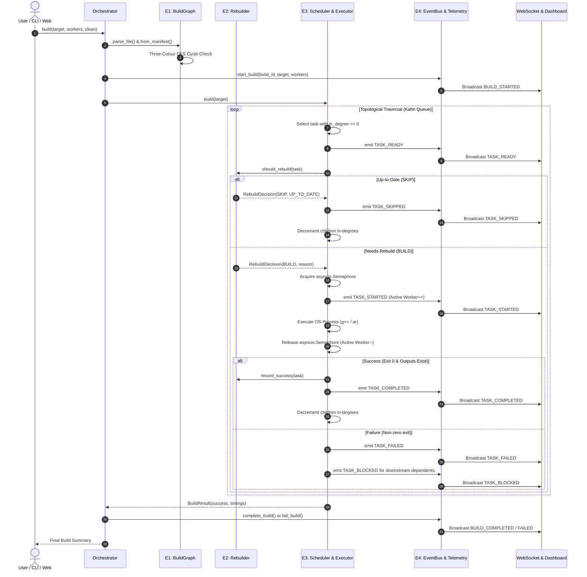

# PROJECT CONTEXT & DEVELOPER HANDOVER SPECIFICATION
## Dependency-Aware Parallel Task Orchestration Engine

> **Document Type:** Developer Onboarding, Architectural Handover & AI Agent Context  
> **Repository:** `https://github.com/Nilakhs/Mini-Project-Dependency-Aware-Orchestration-Engine-.git`  
> **Target Tool:** Antigravity IDE & AI Coding Assistants  
> **Primary Technology Stack:** Python 3.11.9, FastAPI, WebSockets, SQLite (WAL), CMake 4.3+, MinGW GCC 15.2.0  
> **Status:** Production-Ready Academic Mini Project (150/150 Tests Passing, Fully Verified)  
> **Author:** Nilakhs / Systems Software & Parallel Computing Mini Project

---

## Table of Contents
1. [Project Overview, Problem Statement & Objectives](#1-project-overview-problem-statement--objectives)
2. [Complete System Architecture](#2-complete-system-architecture)
3. [In-Depth Subsystem Specifications (E1, E2, E3, E4)](#3-in-depth-subsystem-specifications-e1-e2-e3-e4)
4. [Inter-Engine Communication & Event Protocols](#4-inter-engine-communication--event-protocols)
5. [End-to-End Execution Workflow](#5-end-to-end-execution-workflow)
6. [Formal Graph & Scheduling Algorithms](#6-formal-graph--scheduling-algorithms)
7. [Parallel Execution & Worker Concurrency Model](#7-parallel-execution--worker-concurrency-model)
8. [Dashboard, FastAPI & WebSocket Telemetry Layer](#8-dashboard-fastapi--websocket-telemetry-layer)
9. [Complete Technology Stack & Repository Layout](#9-complete-technology-stack--repository-layout)
10. [Architectural Comparison: Our Engine vs Official Ninja](#10-architectural-comparison-our-engine-vs-official-ninja)
11. [Project Evolution, Completed Phases & Status](#11-project-evolution-completed-phases--status)
12. [Architectural Design Decisions, Constraints & Nuances](#12-architectural-design-decisions-constraints--nuances)
13. [Developer Setup, Run & Testing Guide](#13-developer-setup-run--testing-guide)
14. [Guidelines for AI Coding Agents](#14-guidelines-for-ai-coding-agents)
15. [FIRST INSTRUCTIONS FOR THE NEXT ANTIGRAVITY AGENT](#15-first-instructions-for-the-next-antigravity-agent)

---

## 1. Project Overview, Problem Statement & Objectives

### 1.1 Problem Statement
In compiled languages such as C and C++, large software systems comprise dozens or hundreds of interdependent translation units, header files, static archives, and executable binaries. Compiling these components requires:
1. **Strict Ordering:** An object file cannot be archived into a static library until compilation succeeds; an executable cannot be linked until all referenced libraries and translation units exist.
2. **Dynamic Header Dependencies:** If a shared header (e.g. `math.h`) changes, all translation units including it must be rebuilt, while independent files (e.g. `fileio.cpp`) must be preserved.
3. **Flaws of Traditional Build Systems:**
   * **Coarse Timestamp Invalidation (`mtime`):** Traditional tools like GNU Make rely on filesystem timestamps. Clock skew, Git branch switching, and file touching trigger catastrophic false rebuild cascades.
   * **Black-Box Execution:** Developers lack live visibility into in-degree task readiness, worker slot utilization, critical path progression, and non-blocking failure propagation across independent branches.

### 1.2 Academic Objectives
The **Dependency-Aware Parallel Task Orchestration Engine** is an academic mini project designed to:
- Model and execute real C++ software builds using real CMake-generated `build.ninja` manifests without relying on the compiled `ninja.exe` binary.
- Formally ground build orchestration in the academic principles of ***"Build Systems à la Carte: Theory and Practice"*** (Mokhov, Mitchell, & Peyton Jones).
- Implement a **Topological Scheduler** using dynamic in-degree tracking paired with a **Verifying-Trace Rebuilder** utilizing cryptographic SHA-256 content fingerprints and persistent SQLite caches.
- Provide a full-duplex asynchronous telemetry layer that broadcasts lifecycle events over WebSockets to an interactive real-time HTML5 dashboard.
- Demonstrate empirical speedup and analyze parallel efficiency through **Amdahl's Law**.

---

## 2. Complete System Architecture

The engine is architected into four strictly decoupled subsystems (**E1** through **E4**), coordinated by a central `Orchestrator` and surfaced via a presentation server.

```text
                               +-------------------------------------+
                               |         CMake Configuration         |
                               |          (CMakeLists.txt)           |
                               +-------------------------------------+
                                                  |
                                                  | cmake -S . -B build -G Ninja
                                                  v
                               +-------------------------------------+
                               |       build.ninja & rules.ninja     |
                               +-------------------------------------+
                                                  |
==================================================|==================================================
  CORE BUILD ENGINE (E1 - E4)                     |
==================================================|==================================================
                                                  v
+---------------------------------------------------------------------------------------------------+
| E1: BUILD GRAPH ENGINE (engine/ninja_parser.py, engine/dag.py)                                    |
|   - Streaming lexer & parser for Ninja manifests (rules, build edges, variable scoping)           |
|   - Normalizes filesystem paths and constructs in-memory TaskNode Directed Acyclic Graph (DAG)     |
|   - Maps outputs to producer tasks (producer_map) and resolves phony alias targets                |
|   - Three-Colour DFS Cycle Detection (WHITE -> GRAY -> BLACK) with exact loop reporting           |
|   - Extracts minimal dependency closures for requested target binaries                           |
+---------------------------------------------------------------------------------------------------+
                                                  |
                                                  v
+---------------------------------------------------------------------------------------------------+
| E2: VERIFYING-TRACE REBUILDER (engine/cache.py, engine/rebuilder.py)                              |
|   - Computes SHA-256 cryptographic fingerprints: Command Hash, Input File Bytes, Dependency Hashes|
|   - Reads dynamic compiler-emitted .d depfiles for deep header include tracking                   |
|   - Queries SQLite cache (data/build_state.db in WAL mode) for historical execution traces        |
|   - Returns structured RebuildDecision (BUILD vs SKIP) with 8 explicit reason classifications     |
+---------------------------------------------------------------------------------------------------+
                                                  |
                                                  v
+---------------------------------------------------------------------------------------------------+
| E3: TOPOLOGICAL SCHEDULER & PARALLEL EXECUTOR (engine/scheduler.py, engine/executor.py)           |
|   - Maintains dynamic in-degree counters; tasks transition to READY when all prereqs complete/skip|
|   - Bounded concurrency governed by asyncio.Semaphore(max_workers)                                |
|   - Spawns OS compiler/linker processes asynchronously via asyncio.create_subprocess_exec         |
|   - Emits TASK_STARTED strictly AFTER acquiring worker slot (ensuring accurate concurrency)       |
|   - Handles failure: marks downstream as BLOCKED, isolates failures, allows independent branches  |
+---------------------------------------------------------------------------------------------------+
                                                  |
                                                  v
+---------------------------------------------------------------------------------------------------+
| E4: BUILD TELEMETRY ENGINE (telemetry/collector.py, telemetry/event_bus.py, telemetry/db.py)      |
|   - Intercepts 9 typed lifecycle events: BUILD_*, TASK_READY, STARTED, SKIPPED, COMPLETED, etc.  |
|   - Tracks active worker count, true peak concurrency, CPU durations, and task states            |
|   - Persists execution history to SQLite database (telemetry_builds, telemetry_events)            |
|   - Publishes events synchronously to in-memory EventBus observers                                |
+---------------------------------------------------------------------------------------------------+
                                                  |
                                                  +-----------------------+
                                                  |                       |
                                                  v                       v
                                   +--------------------------+  +--------------------------+
                                   |   FastAPI REST API       |  |  WebSocket Broadcaster   |
                                   |   (api/main.py)          |  |  (api/websocket.py)      |
                                   |   GET /api/status, graph |  |  WS /ws/telemetry        |
                                   +--------------------------+  +--------------------------+
                                                  \                       /
                                                   \                     /
                                                    v                   v
                                      +-----------------------------------------------+
                                      |             Live Web Dashboard                |
                                      |             (dashboard/app.js)                |
                                      |    - SVG DAG with dynamic state colors        |
                                      |    - Real-time Concurrency & KPI metric cards |
                                      |    - Gantt timeline & historical inspector    |
                                      +-----------------------------------------------+
```

---

## 3. In-Depth Subsystem Specifications (E1, E2, E3, E4)

### 3.1 Subsystem E1: Build Graph Engine (DAG)
* **Primary Modules:** [`engine/models.py`](file:///c:/Users/nilak/Github/Mini%20Project(Dependency%20Aware%20Task%20Orchestration%20Engine)/engine/models.py), [`engine/ninja_parser.py`](file:///c:/Users/nilak/Github/Mini%20Project(Dependency%20Aware%20Task%20Orchestration%20Engine)/engine/ninja_parser.py), [`engine/dag.py`](file:///c:/Users/nilak/Github/Mini%20Project(Dependency%20Aware%20Task%20Orchestration%20Engine)/engine/dag.py)
* **Core Responsibilities:**
  1. **Ninja Manifest Parsing:** Parses CMake-generated `build.ninja` manifests, handling variable declarations (`var = value`), expansions (`$var`, `${var}`, `$in`, `$out`), escape sequences (`$$`, `$:`, `$ `), line continuations (`$`), included rule manifests (`CMakeFiles/rules.ninja`), and subninjas.
  2. **Path Normalization:** Normalizes Windows/POSIX path separators to forward slashes (`/`), lowercases path keys for case-insensitive Windows filesystem lookups, and strips redundant `.` and `..` segments.
  3. **Producer Inversion:** Builds an inverted index mapping each output file to its producing `TaskNode` (`producer_map: dict[str, TaskNode]`).
  4. **Dependency Classification:**
     * **Explicit Inputs (`$in`):** Passed directly on the compiler command line; modification triggers rebuilds.
     * **Implicit Dependencies (`|`):** Not passed on the command line, but modifications invalidate the target.
     * **Order-Only Dependencies (`||`):** Enforce execution ordering; modifications do *not* trigger rebuilds.
  5. **Phony Target Resolution:** Resolves CMake phony aliases (e.g., `cmake_object_order_depends_target_mylib`, `all`) down to their underlying concrete compilation tasks.
  6. **Cycle Detection:** Executes formal **Three-Colour Depth-First Search** (`WHITE` = unvisited, `GRAY` = visiting on recursion stack, `BLACK` = fully explored). Reaching a `GRAY` node signals a back-edge (directed cycle), raising a `CycleError` with the exact path.
  7. **Closure Extraction:** Computes the minimal transitive dependency closure for any target (e.g. `demo.exe`), pruning unneeded graph nodes.

### 3.2 Subsystem E2: Verifying-Trace Rebuilder
* **Primary Modules:** [`engine/cache.py`](file:///c:/Users/nilak/Github/Mini%20Project(Dependency%20Aware%20Task%20Orchestration%20Engine)/engine/cache.py), [`engine/rebuilder.py`](file:///c:/Users/nilak/Github/Mini%20Project(Dependency%20Aware%20Task%20Orchestration%20Engine)/engine/rebuilder.py)
* **Core Responsibilities:**
  1. **Cryptographic Fingerprinting:** Replaces fragile filesystem timestamps (`mtime`) with deterministic SHA-256 hashes:
     * **Command Hash:** `H(rule_command || edge_variables)` — catches compiler flag modifications.
     * **Input Fingerprint:** `H(H(f1) + H(f2) + ...)` — hashes raw bytes of all explicit and implicit input files.
     * **Dependency Fingerprint:** `H(H(dep1) + H(dep2) + ...)` — hashes upstream parent task states.
  2. **Dynamic Compiler Depfile (`.d`) Integration:** GCC and Clang emit makefile snippets (`-MD -MF file.d`) during compilation listing included header files. E2 dynamically parses these `.d` files and incorporates header byte hashes into the task's input fingerprint.
  3. **Persistent SQLite Trace Storage:** Maintains historical build traces in `build_state.db` under the `build_traces` table using Write-Ahead Logging (WAL) for high concurrency and zero locking conflicts.
  4. **Decision Categorization:** Evaluates the live graph state against the cache and yields a `RebuildDecision`:
     * `FIRST_BUILD`: No prior trace in database.
     * `MISSING_INPUT`: A declared source or header file is missing on disk.
     * `OUTPUT_MISSING`: The target artifact (`.obj`, `.a`, `.exe`) does not exist on disk.
     * `OUTPUT_MODIFIED`: Disk hash of output artifact does not match previous trace.
     * `COMMAND_CHANGED`: Build rule command line or flags were modified in manifest.
     * `INPUT_CHANGED`: Cryptographic content hash of an input file changed.
     * `DEPENDENCY_CHANGED`: An upstream prerequisite task was rebuilt.
     * `UP_TO_DATE`: All checks pass; the task is skipped (`SKIP`).

### 3.3 Subsystem E3: Topological Scheduler & Parallel Executor
* **Primary Modules:** [`engine/scheduler.py`](file:///c:/Users/nilak/Github/Mini%20Project(Dependency%20Aware%20Task%20Orchestration%20Engine)/engine/scheduler.py), [`engine/executor.py`](file:///c:/Users/nilak/Github/Mini%20Project(Dependency%20Aware%20Task%20Orchestration%20Engine)/engine/executor.py)
* **Core Responsibilities:**
  1. **Dynamic In-Degree Tracking:** For every task in the dependency closure, tracks `in_degree` (count of pending prerequisites). Tasks with `in_degree == 0` are placed in the `ready_queue`.
  2. **Skipped Task Bypass:** If E2 marks a task `SKIP`, the scheduler immediately marks it `SKIPPED`, bypasses subprocess creation, and decrements downstream dependents' in-degrees, unblocking children in microseconds.
  3. **Bounded Asynchronous Concurrency:** Controls concurrent execution using `asyncio.Semaphore(max_workers)`.
  4. **Accurate Concurrency Signaling:** The `TASK_STARTED` event is emitted via an `on_start` callback *after* the worker slot semaphore is acquired. This guarantees that telemetry concurrency reflects physical OS processes rather than queued coroutines.
  5. **Non-Blocking OS Process Dispatch:** Spawns compiler (`g++`) and archiver (`ar`) commands via `asyncio.create_subprocess_exec`, capturing `stdout`, `stderr`, and exit codes.
  6. **Failure Isolation:** On non-zero exit or missing outputs, marks the task `FAILED`, transitions all downstream dependents to `BLOCKED`, and permits independent sibling branches to continue safely.

### 3.4 Subsystem E4: Build Telemetry Engine
* **Primary Modules:** [`telemetry/events.py`](file:///c:/Users/nilak/Github/Mini%20Project(Dependency%20Aware%20Task%20Orchestration%20Engine)/telemetry/events.py), [`telemetry/event_bus.py`](file:///c:/Users/nilak/Github/Mini%20Project(Dependency%20Aware%20Task%20Orchestration%20Engine)/telemetry/event_bus.py), [`telemetry/collector.py`](file:///c:/Users/nilak/Github/Mini%20Project(Dependency%20Aware%20Task%20Orchestration%20Engine)/telemetry/collector.py), [`telemetry/db.py`](file:///c:/Users/nilak/Github/Mini%20Project(Dependency%20Aware%20Task%20Orchestration%20Engine)/telemetry/db.py), [`telemetry/report.py`](file:///c:/Users/nilak/Github/Mini%20Project(Dependency%20Aware%20Task%20Orchestration%20Engine)/telemetry/report.py)
* **Core Responsibilities:**
  1. **Typed Lifecycle Events:** Dispatches 9 structured events:
     `BUILD_STARTED`, `TASK_READY`, `TASK_STARTED`, `TASK_SKIPPED`, `TASK_COMPLETED`, `TASK_FAILED`, `TASK_BLOCKED`, `BUILD_COMPLETED`, `BUILD_FAILED`.
  2. **In-Memory EventBus:** Synchronous observer distribution model isolating event handlers from build execution errors.
  3. **Metrics Aggregation:** Computes active concurrency, peak concurrency, wall-clock durations, CPU times, cache hit ratios, and task state dictionaries.
  4. **Time-Series Persistence:** Records build summaries (`telemetry_builds`) and granular event logs (`telemetry_events`) in SQLite (`data/build_state.db`).
  5. **Comparison & Benchmarking:** Computes speedup factor ($S_p = \bar{T}_1 / \bar{T}_p$), parallel efficiency ($E_p = S_p / p \times 100\%$), absolute time saved ($\Delta T$), and percentage reduction.

---

## 4. Inter-Engine Communication & Event Protocols

All subsystems operate under strict unidirectional data flow, coordinated by `Orchestrator`:



---

## 5. End-to-End Execution Workflow

### 5.1 Step-by-Step Build Pipeline
1. **Invocation:** The build is triggered via `python cli.py build [target]` or `POST /api/build/start`.
2. **Clean Check:** If `--clean` is requested, `clean_artifacts()` wipes `.obj`, `.a`, `.exe`, and clears the SQLite trace tables.
3. **Manifest Ingestion:** `NinjaParser` parses `build.ninja` and `rules.ninja`, resolving variable substitutions and escape sequences.
4. **DAG Construction:** `BuildGraph` constructs task nodes and indexes target outputs.
5. **Cycle Validation:** Three-Colour DFS verifies the graph is strictly acyclic.
6. **Closure Pruning:** Only the nodes required to produce the requested target are selected.
7. **Telemetry Initialization:** `TelemetryCollector.start_build()` logs the session and dispatches `BUILD_STARTED`.
8. **Asynchronous Execution:**
   - Ready tasks (in-degree 0) enter the scheduling queue.
   - For each task, E2 checks SHA-256 fingerprints against `build_state.db`.
   - If up-to-date, `TASK_SKIPPED` is emitted, and child tasks are unblocked immediately.
   - If rebuild is required, the task awaits a semaphore slot, emits `TASK_STARTED`, spawns the compiler, verifies output existence, records the new trace in SQLite via `record_success()`, and emits `TASK_COMPLETED`.
9. **Finalization:** Telemetry records are committed, duration metrics are finalized, and `BUILD_COMPLETED` is broadcast.

---

## 6. Formal Graph & Scheduling Algorithms

### 6.1 Algorithm 1: Three-Colour Depth-First Search Cycle Detection
* **Purpose:** Proves graph acyclicity before execution; pinpoints circular dependency loops.
* **Colors:**
  * `WHITE` (0): Unvisited node.
  * `GRAY` (1): Node is on the active DFS recursion stack.
  * `BLACK` (2): Node and all its descendants have been fully explored.
* **Mechanism:** If an outgoing edge points to a `GRAY` node, a back-edge is identified, proving a cycle.
* **Complexity:** Time: $\mathcal{O}(|V| + |E|)$, Space: $\mathcal{O}(|V|)$.

```python
def check_cycles_three_color(nodes: dict[str, TaskNode]) -> list[str]:
    WHITE, GRAY, BLACK = 0, 1, 2
    color = {node_id: WHITE for node_id in nodes}
    stack = []
    
    def dfs(u: str) -> Optional[list[str]]:
        color[u] = GRAY
        stack.append(u)
        for v in nodes[u].explicit_deps + nodes[u].implicit_deps + nodes[u].order_only_deps:
            if v in color:
                if color[v] == GRAY:
                    cycle_start = stack.index(v)
                    return stack[cycle_start:] + [v]
                if color[v] == WHITE:
                    res = dfs(v)
                    if res: return res
        stack.pop()
        color[u] = BLACK
        return None

    for node_id in nodes:
        if color[node_id] == WHITE:
            cycle = dfs(node_id)
            if cycle: return cycle
    return []
```

### 6.2 Algorithm 2: Kahn-Style Parallel Topological Scheduler
* **Purpose:** Dynamically identifies ready tasks and coordinates asynchronous execution.
* **Mechanism:** Tracks remaining prerequisites (`in_degree`). Decrements count upon prerequisite completion or skipping. Enqueues task when `in_degree == 0`.
* **Complexity:** Scheduling logic: $\mathcal{O}(|V| + |E|)$; Wall-clock time: $\mathcal{O}(T_{\text{critical}} + \frac{1}{p} \sum T_i)$.

---

## 7. Parallel Execution & Worker Concurrency Model

### 7.1 Concurrency Bounding
Concurrency is strictly controlled by an `asyncio.Semaphore(max_workers)`:
```python
async with self.semaphore:
    worker_id = self._pool.acquire_worker_id()
    try:
        # on_start hook fires AFTER semaphore slot is physically obtained
        if self.on_start:
            self.on_start(task_id, worker_id)
        result = await self._execute_process(...)
    finally:
        self._pool.release_worker_id(worker_id)
```

### 7.2 The Telemetry Concurrency Invariant
In earlier prototypes, `TASK_STARTED` was emitted when a task entered the scheduling coroutine, falsely reporting coroutines waiting for the semaphore as "active workers". This was resolved in Phase 7:
* `TASK_STARTED` fires strictly *after* `semaphore.acquire()`.
* The displayed active worker metric accurately represents physical subprocesses currently running on the OS.
* `peak_concurrency` records the maximum simultaneous active worker count ($1 \le \text{Peak} \le \text{max\_workers}$).

---

## 8. Dashboard, FastAPI & WebSocket Telemetry Layer

### 8.1 REST Endpoints ([`api/main.py`](file:///c:/Users/nilak/Github/Mini%20Project(Dependency%20Aware%20Task%20Orchestration%20Engine)/api/main.py))
* `GET /api/status`: Returns current build status, active workers, peak concurrency, wall time, and task counters.
* `GET /api/graph`: Returns graph topology (nodes, edges, dependencies) with live task statuses.
* `GET /api/builds`: Lists historical build sessions.
* `GET /api/builds/{build_id}`: Detailed telemetry event logs for a specific build.
* `GET /api/comparison`: Comparative performance metrics between sequential and parallel builds.
* `POST /api/build/start`: Initiates a build session (`{"target": "all", "workers": 4, "clean": false}`).
* `POST /api/benchmark/run`: Executes sequential vs. parallel multi-trial benchmark.
* `WS /ws/telemetry`: WebSocket streaming live JSON lifecycle events.

### 8.2 Frontend Architecture ([`dashboard/`](file:///c:/Users/nilak/Github/Mini%20Project(Dependency%20Aware%20Task%20Orchestration%20Engine)/dashboard/))
* Plain HTML5, CSS3, and modern Vanilla JavaScript without external framework dependencies.
* Dynamically constructs an interactive SVG Directed Acyclic Graph.
* State indicators:
  * `PENDING`: Light Slate Grey (`#94A3B8`)
  * `READY`: Amber (`#F59E0B`)
  * `RUNNING`: Pulsing Blue (`#3B82F6`)
  * `COMPLETED`: Emerald Green (`#10B981`)
  * `SKIPPED`: Slate Muted (`#64748B`)
  * `FAILED`: Crimson Red (`#EF4444`)
  * `BLOCKED`: Orange Warning (`#F97316`)

---

## 9. Complete Technology Stack & Repository Layout

### 9.1 Technology Stack
* **Language & Runtime:** Python 3.11.9 Virtual Environment (`.venv`)
* **Asynchronous Framework:** Python `asyncio` Event Loop
* **API Framework:** FastAPI 0.104+, Uvicorn 0.24+
* **WebSocket Server:** `websockets` 12.0+
* **Database Engine:** SQLite 3 with Write-Ahead Logging (`PRAGMA journal_mode=WAL`)
* **Compiler Toolchain:** MinGW GNU C++ (`g++ 15.2.0`, `GNU ar 2.44`)
* **Build Manifest Generator:** CMake 4.3+ (`cmake -S . -B build -G Ninja`)
* **Test Harness:** Pytest 7.4+ & `pytest-asyncio` (150 passing tests)
* **Frontend:** HTML5, CSS3, Vanilla ES6 JavaScript, SVG

### 9.2 Complete File Tree & Purpose
```text
.
├── .venv/                         # Python 3.11 virtual environment
├── api/
│   ├── __init__.py                # Package initializer
│   ├── main.py                    # FastAPI server & REST endpoints
│   └── websocket.py               # WebSocket ConnectionManager
├── dashboard/
│   ├── app.js                     # Dashboard WebSocket client & DAG renderer
│   ├── index.html                 # Main dashboard UI structure
│   └── style.css                  # Dark-mode responsive styling
├── data/
│   └── build_state.db             # SQLite database for traces & telemetry (WAL)
├── documentation/
│   ├── Ninja_Build_System_Architecture_and_Workflow.pdf # 19-page Academic Monograph
│   └── PROJECT_CONTEXT.md         # THIS COMPLETE HANDOVER DOCUMENT
├── engine/
│   ├── __init__.py                # Package initializer
│   ├── cache.py                   # SQLite BuildCache (build_traces table)
│   ├── dag.py                     # BuildGraph, TaskNode, 3-Colour DFS
│   ├── executor.py                # AsyncProcessExecutor & WorkerPool
│   ├── models.py                  # Core dataclasses (BuildRule, BuildEdge, TaskNode)
│   ├── ninja_parser.py            # Ninja manifest lexer, parser, variable expansion
│   ├── orchestrator.py            # Central Orchestrator coordinating E1-E4
│   ├── rebuilder.py               # Rebuilder (SHA-256 verifying traces)
│   └── scheduler.py               # TopologicalScheduler (in-degree Kahn queue)
├── examples/
│   └── cpp_demo/                  # Real C++ demonstration codebase
│       ├── build/                 # Out-of-source CMake build directory
│       │   ├── build.ninja        # Real CMake-generated Ninja manifest
│       │   └── CMakeFiles/
│       │       └── rules.ninja    # Compiler & linker rule declarations
│       ├── include/               # C++ header files (math.h, utils.h, etc.)
│       ├── src/                   # C++ source files (math.cpp, main.cpp, etc.)
│       └── CMakeLists.txt         # Root CMake project configuration
├── telemetry/
│   ├── __init__.py                # Package initializer
│   ├── collector.py               # TelemetryCollector (metrics & active concurrency)
│   ├── db.py                      # TelemetryDB (builds & events tables)
│   ├── event_bus.py               # Synchronous in-memory EventBus
│   ├── events.py                  # TelemetryEvent & TelemetryEventType
│   └── report.py                  # Benchmark calculation & Amdahl formulas
├── tests/
│   ├── test_cache.py              # E2 cache unit tests
│   ├── test_dag.py                # E1 DAG construction & cycle detection tests
│   ├── test_executor.py           # E3 subprocess executor tests
│   ├── test_integration.py        # End-to-end full build tests
│   ├── test_ninja_parser.py       # E1 parser & variable expansion tests
│   ├── test_rebuilder.py          # E2 rebuild decision tests
│   ├── test_scheduler.py          # E3 topological scheduling tests
│   └── test_telemetry.py          # E4 event bus & metrics tests
├── ARCHITECTURE.md                # System architecture documentation
├── BENCHMARK_REPORT.md            # Empirical performance benchmark findings
├── cli.py                         # Unified Command-Line Interface
├── DEMO_GUIDE.md                  # Step-by-step academic presentation guide
├── pytest.ini                     # Pytest configuration
├── README.md                      # Public project overview & badges
└── requirements.txt               # Project Python dependencies
```

---

## 10. Architectural Comparison: Our Engine vs Official Ninja

| Feature / Dimension | Official Ninja Build System | Our Custom Orchestration Engine |
| :--- | :--- | :--- |
| **Language & Runtime** | C++11 native binary (`ninja.exe`) | Python 3.11 asynchronous event loop (`asyncio`) |
| **Manifest Compatibility** | Native `build.ninja` specification | Parses CMake-generated `build.ninja` subset directly |
| **Execution Method** | Native OS process spawning | `asyncio.create_subprocess_exec` (does NOT call `ninja.exe`) |
| **Rebuild Mechanism** | File modification timestamps (`mtime`) + command hash | **Verifying Traces:** SHA-256 content hashes of files & commands |
| **Dynamic Headers** | `.ninja_deps` binary format | Parses compiler `.d` depfiles into SQLite cache |
| **Cycle Detection** | Traversal validation during graph scan | **Three-Colour DFS** (`WHITE`/`GRAY`/`BLACK`) with path reporting |
| **Scheduling Algorithm** | Priority queue with ready dependency tracking | **Kahn-Style Topological Scheduling** with dynamic in-degree queue |
| **Concurrency Control** | POSIX / Windows event poll loop (`-jN`) | `asyncio.Semaphore(max_workers)` with verified acquisition timing |
| **Persistent Storage** | Flat `.ninja_log` + binary `.ninja_deps` | Structured SQLite database (`data/build_state.db`) in WAL mode |
| **Observability** | Command-line text output only | **Live Web Dashboard:** WebSocket event stream, SVG DAG, KPIs |

---

## 11. Project Evolution, Completed Phases & Status

### 11.1 Evolution from YAML to Ninja Manifests
* **Early Prototype (Phase 0):** Used a synthetic YAML schema (`tasks.yaml`). While adequate for initial graph logic testing, YAML manifests could not represent real C++ header dependencies, compiler depfiles, or standard toolchain integration.
* **Modern Architecture (Phase 1–6):** The engine was upgraded to parse real CMake-generated `build.ninja` files. It compiles real C++ code with MinGW GCC and GNU `ar`.

### 11.2 Completed Phases & Test Verification
* **Phase 1 (Manifest Parser):** 64/64 tests passed.
* **Phase 2 (Build Graph Engine):** 20 additional tests passed (84 total).
* **Phase 3 (Verifying-Trace Rebuilder):** Rebuilder & SQLite cache operational.
* **Phase 4 (Topological Scheduler & Executor):** Parallel asynchronous execution operational.
* **Phase 5 (Telemetry Engine & Dashboard):** Live WebSockets & SVG dashboard operational.
* **Phase 6 (Final Integration & Bug Fixes):** Concurrency telemetry audit completed (150/150 tests passing).
* **Phase 7 (Academic Monograph):** 19-page PDF generated in `documentation/`.

### 11.3 Empirical Benchmark Findings ([`BENCHMARK_REPORT.md`](file:///c:/Users/nilak/Github/Mini%20Project(Dependency%20Aware%20Task%20Orchestration Engine)/BENCHMARK_REPORT.md))
* **Clean Sequential ($1$ worker):** $4.900\text{ s} \pm 0.112\text{ s}$
* **Clean Parallel ($4$ workers):** $2.075\text{ s} \pm 0.038\text{ s}$
* **Empirical Speedup ($S_4$):** **$2.36\times$**
* **Parallel Efficiency ($E_4$):** **$59.0\%$** (achieves **$96.3\%$ of Amdahl's theoretical limit** for this graph)
* **Wall-Clock Reduction:** **$57.6\%$** (time saved: $2.825\text{ s}$)
* **Cached No-Op Rebuild:** **$0.232\text{ s}$** (**$21.2\times$ faster** than sequential)
* **Single-File Incremental Rebuild:** **$0.588\text{ s}$** (**$8.3\times$ faster** than clean parallel)

---

## 12. Architectural Design Decisions, Constraints & Nuances

1. **Self-Contained Execution:** The engine does **not** invoke `ninja.exe`. All parsing, DAG modeling, dirty checking, process spawning, and telemetry are executed by our Python codebase.
2. **Cryptographic Integrity over Timestamps:** We deliberately chose SHA-256 hashing over `mtime`. If a file is touched without changing its content, E2 skips it. If a Git branch switch changes content while preserving timestamps, E2 detects the change.
3. **Semaphore Timing Invariant:** Telemetry `TASK_STARTED` must fire *after* `semaphore.acquire()`. Never move it prior to acquisition.
4. **CMake Utility Rules Scoped Out:** Targets such as `rebuild_cache`, `edit_cache`, and `clean` are classified as utilities and bypassed during standard compilation closures.
5. **Windows Path Normalization:** On Windows, file paths are case-insensitive and use backslashes. All internal engine keys normalize paths to lowercase with forward slashes (`math/utils.cpp`).
6. **No-Op Manifest Invalidation:** The engine consumes an existing `build.ninja`. If `CMakeLists.txt` is modified, CMake must be run manually to refresh `build.ninja`.

---

## 13. Developer Setup, Run & Testing Guide

### 13.1 Prerequisites
* Windows 10/11 (or Linux/macOS with appropriate compiler adjustments)
* Python 3.11.9
* MinGW-w64 GNU C++ (`g++` and `ar` in system `PATH`)
* CMake 3.20+ (CMake 4.3+ verified)

### 13.2 Environment Setup
```powershell
# 1. Clone repository
git clone https://github.com/Nilakhs/Mini-Project-Dependency-Aware-Orchestration-Engine-.git
cd "Mini-Project-Dependency-Aware-Orchestration-Engine-"

# 2. Activate Python virtual environment
.\.venv\Scripts\Activate.ps1

# 3. Verify toolchain
python --version    # Expected: Python 3.11.x
g++ --version       # Expected: g++ (Rev... MinGW-w64)
cmake --version     # Expected: cmake version 3.x or 4.x
```

### 13.3 CLI Commands
```powershell
# Launch the live web dashboard
python cli.py dashboard
# Open browser at: http://127.0.0.1:8000

# Run a clean parallel build (4 workers, default)
python cli.py build --clean --workers 4

# Run a clean sequential build (1 worker baseline)
python cli.py build --clean --workers 1

# Run an incremental build
python cli.py build

# Run build for a specific target binary
python cli.py build --target demo.exe

# Execute reproducible multi-trial benchmark
python cli.py benchmark --trials 3

# View historical builds stored in SQLite
python cli.py history

# Run complete automated test suite
python cli.py test
```

---

## 14. Guidelines for AI Coding Agents

When working on this codebase in Antigravity or any agentic coding environment:
1. **Preserve Subsystem Boundaries:** Never cross-import across forbidden boundaries. E1 must not know about E3/E4. E2 must remain a pure decision engine without subprocess execution logic.
2. **Do Not Touch Core Functionality Unnecessarily:** All 150 tests pass. Do not refactor or rewrite working modules.
3. **Respect Rebuild Contracts:** Always update traces via `record_success()` *only after* a subprocess returns code 0 and its declared outputs exist on disk.
4. **Preserve Path Normalization:** Always pass file paths through `normalize_path()` or `path_lookup_key()` before dictionary lookups.
5. **Always Run Pytest After Any Change:** Run `python -m pytest` to confirm all 150 tests remain green.

---

## 15. FIRST INSTRUCTIONS FOR THE NEXT ANTIGRAVITY AGENT

> **CRITICAL DIRECTIVE FOR THE NEXT AGENT:**  
> Read this section before performing any action.

### Immediate State Assessment:
* **Current Status:** The project is **100% complete, fully verified, and functionally frozen**.
* **Repository State:** Branch `main` is clean. All 150 automated tests pass.
* **Documentation State:** The project contains comprehensive documentation:
  * [`README.md`](file:///c:/Users/nilak/Github/Mini%20Project(Dependency%20Aware%20Task%20Orchestration%20Engine)/README.md): Public repository overview and quick start.
  * [`ARCHITECTURE.md`](file:///c:/Users/nilak/Github/Mini%20Project(Dependency%20Aware%20Task%20Orchestration%20Engine)/ARCHITECTURE.md): Detailed subsystem architecture and design patterns.
  * [`DEMO_GUIDE.md`](file:///c:/Users/nilak/Github/Mini%20Project(Dependency%20Aware%20Task%20Orchestration%20Engine)/DEMO_GUIDE.md): 7–10 minute oral demonstration script for university faculty.
  * [`BENCHMARK_REPORT.md`](file:///c:/Users/nilak/Github/Mini%20Project(Dependency%20Aware%20Task%20Orchestration%20Engine)/BENCHMARK_REPORT.md): Empirical scaling benchmarks and Amdahl's Law derivations.
  * [`documentation/Ninja_Build_System_Architecture_and_Workflow.pdf`](file:///c:/Users/nilak/Github/Mini%20Project(Dependency%20Aware%20Task%20Orchestration%20Engine)/documentation/Ninja_Build_System_Architecture_and_Workflow.pdf): 19-page formal academic monograph.
  * [`documentation/PROJECT_CONTEXT.md`](file:///c:/Users/nilak/Github/Mini%20Project(Dependency%20Aware%20Task%20Orchestration%20Engine)/documentation/PROJECT_CONTEXT.md): This complete technical context file.

### Rules of Engagement:
1. **DO NOT Refactor or Rewrite:** Do not modify `engine/`, `telemetry/`, `api/`, or `dashboard/` unless the user explicitly requests a new feature or reports a bug.
2. **DO NOT Overwrite PDF or Docs:** The academic PDF in `documentation/` is finalized and visually audited.
3. **If Asked to Run the System:** Use `python cli.py dashboard` to launch the server or `python cli.py build` for execution.
4. **If Asked to Run Tests:** Use `pytest` via `.venv\Scripts\python.exe -m pytest` or `python cli.py test`.
5. **Maintain Context Integrity:** All technical explanations given to the user must reflect the actual verified code and benchmark numbers in this document.
